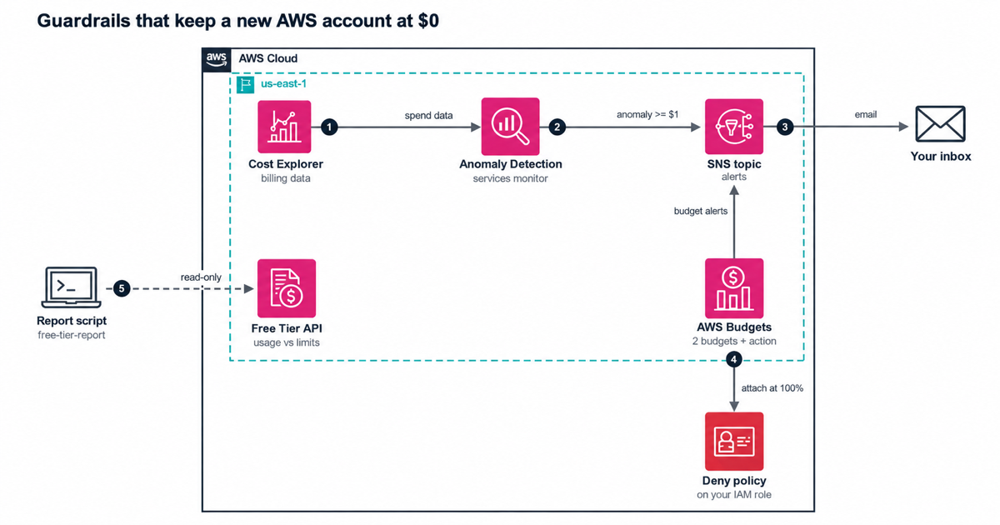

# Guardrails for a $0 AWS account

A new AWS account gets the Free plan or the Paid plan, up to $200 in credits, and more than 30 services with always-free monthly allowances. None of that stops a forgotten NAT gateway from billing you. This repo deploys the guardrails AWS gives you for that, with tests, in one AWS CDK (TypeScript) stack:

- a zero-spend budget that emails you when gross spend passes one cent
- a monthly cost budget with alerts at 80% of actual spend and 100% of forecast spend
- a budget action that attaches a deny policy to the IAM role or group you work in once spend reaches the limit
- a Cost Anomaly Detection subscription that sends each anomaly of $1 or more as it's found
- one Amazon SNS topic that carries all of it to your inbox

It also has `npm run free-tier-report`, a read-only script that prints this month's Free Tier usage against each limit and flags anything at 80% or more.

## Architecture



## What it costs

Nothing, inside the free allowances. AWS Budgets is free for monitoring, and the first two budgets with actions are free each month. This stack has one. Cost Anomaly Detection has no charge. SNS sends the first 1,000 emails each month for free, far more than these alerts need. [docs/cost.md](docs/cost.md) has the sources and the one choice that would cost money (a KMS key for the topic).

## Deploy

You need Node.js 24, AWS credentials for the account, and a CDK-bootstrapped us-east-1. The Budgets, Cost Explorer and Free Tier APIs all live there, so the stack deploys to us-east-1 whatever your default Region is.

```bash
npm ci
npm run check
npx cdk deploy \
  -c alertEmail=you@example.com \
  -c monthlyLimitUsd=5 \
  -c restrictRoles=Developer
```

Then confirm the SNS subscription email. Until you click the link, no alert reaches you.

| Context key | Meaning | Default |
|---|---|---|
| `alertEmail` | Where alerts go | required |
| `monthlyLimitUsd` | Monthly cost budget in USD | 5 |
| `restrictRoles` | Comma-separated IAM role names that get the deny policy | at least one role or group |
| `restrictGroups` | Comma-separated IAM group names that get the deny policy | at least one role or group |
| `actionThresholdPercent` | Percent of the monthly budget, on actual spend, that runs the action | 100 |
| `anomalyThresholdUsd` | Smallest anomaly impact that sends an alert | 1 |
| `anomalyMonitorArn` | An AWS services anomaly monitor you already have | creates one |

### If you already have an anomaly monitor

An account can hold one AWS services anomaly monitor, and AWS creates one for many new Cost Explorer users. If the deploy fails on the monitor, find the one you have and pass it in:

```bash
aws ce get-anomaly-monitors --region us-east-1 --query 'AnomalyMonitors[].MonitorArn'
npx cdk deploy -c anomalyMonitorArn=arn:aws:ce::123456789012:anomalymonitor/... (plus the keys above)
```

## The Free Tier report

```bash
npm run free-tier-report             # prints the report, exits 0
npm run free-tier-report -- --strict # exits 2 if anything is flagged, for a scheduled job
```

It calls `GetAccountPlanState` and `GetFreeTierUsage` and nothing else. The caller needs `freetier:GetAccountPlanState` and `freetier:GetFreeTierUsage`. Each line gets a status:

| Status | Meaning |
|---|---|
| `OVER` | Usage this month has reached the limit |
| `FORECAST_OVER` | AWS forecasts the month will end over the limit |
| `AT_80` | Usage has reached 80% of the limit |
| `OK` | Under 80%, forecast under the limit |
| `NO_LIMIT` | The line has no limit to compare against |

## What the budget action does and doesn't do

Once actual spend reaches the limit, AWS Budgets attaches the `ZeroSpendGuardrails-spend-freeze` policy to the roles and groups you named. The policy denies the API calls that start hourly or per-call charges: launching or starting EC2 instances, creating NAT gateways, Elastic IPs, interface endpoints and load balancers, creating or starting RDS databases, ECS and EKS work, SageMaker endpoints, and Bedrock model calls. It also denies assuming the CDK bootstrap roles (`cdk-*`) and passing any role with `iam:PassRole`, so a frozen role can't get around it with `cdk deploy` or by handing a role to CloudFormation.

It doesn't stop anything that's already running. A NAT gateway created before the freeze keeps billing until you delete it. It also doesn't apply to the root user, which is one more reason to work in a role. And it only covers the roles and groups you name: if your role can assume some other role that isn't named, that role can still create resources, so name it too. [docs/runbook.md](docs/runbook.md) says what to do when the freeze fires and how to lift it.

## Tests

| Command | What runs |
|---|---|
| `npm test` | Unit tests for the report (aws-sdk-client-mock), a flow test that runs the real CLI against a local HTTP stand-in for the Free Tier API, CDK template tests, cdk-nag and CloudFormation schema checks |
| `npm run check` | Type check, lint, tests and `cdk synth` |

Each key safeguard was broken on purpose once to confirm a test fails: the budget action, the deny statements, both SNS publish permissions, the topic policy dependency, the credit setting, the execution role's scope, and the report's thresholds and pagination.

## More docs

- [docs/security.md](docs/security.md): who can do what, and why the topic isn't KMS encrypted
- [docs/cost.md](docs/cost.md): what each part costs, with sources
- [docs/runbook.md](docs/runbook.md): what to do when an alert or the freeze fires

## Clean up

`npx cdk destroy` removes the whole stack, budgets included. If the freeze sits on a role when you destroy, reverse the action in the AWS Budgets console first, or detach the policy from the role, so CloudFormation can delete the policy.
